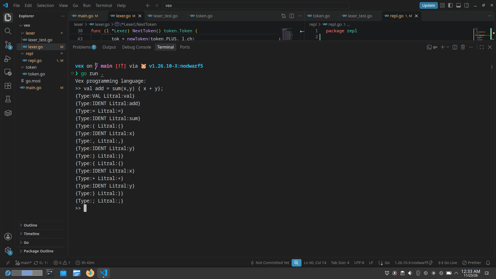
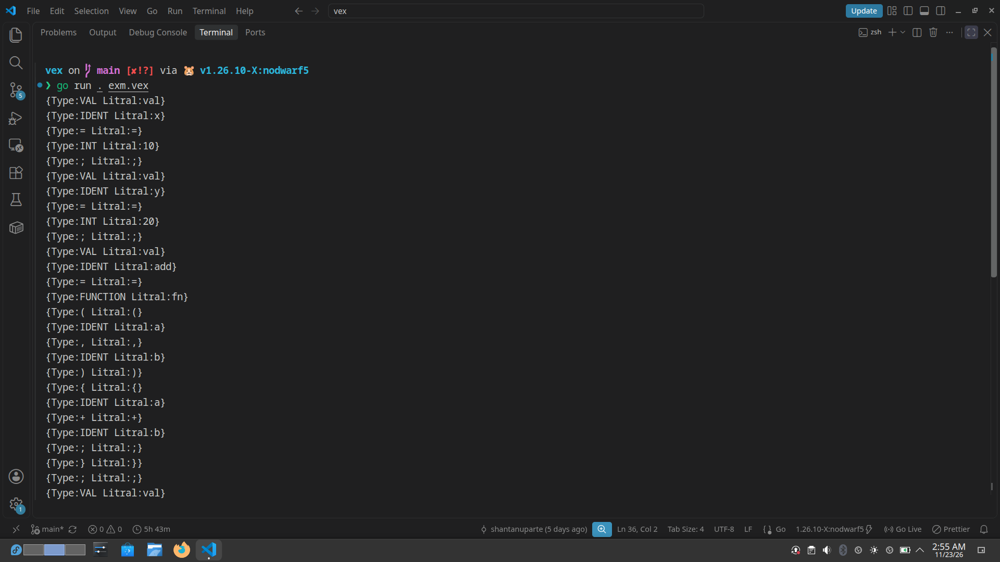

# Vex

My own programming language

```
// A simple Vex program to test variables, functions, and conditions
val x = 10;
val y = 20;

val add = fn(a, b) {
    a + b;
};

val total = add(x, y);

if (total > 25) {
    return true;
} else {
    return false;
}
```

## Run it

It's still incomplete(it's new and faily big for me) with first version of the lexer only and repl

for using the program just clone the program

```
git clone https://github.com/shantanuparte/vex.git
cd vex
```

in program to run the repl just do

```
go run .
```

for something like


if you want to run though source file do

```
go run . {filepath}
```

so it's execute though the source file



for lexer_test and testing you stuff do

```
go test ./lexer
```

I'm currently learnig and Will continue this project for further weeks
Thank you :)
